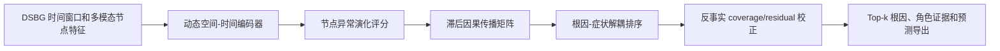

# REACR-RCA V2：微服务根因定位

REACR-RCA V2 面向微服务故障的实例级 Top-k 根因定位。方法主线是：**动态异常演化建模 + 根因-症状解耦排序 + 反事实传播证据校正**。

## 版本说明

| 版本 | Git tag | 定位 | 主要内容 |
| --- | --- | --- | --- |
| V1.0 | `v1.0.0-baseline` | 初始基线 | REACT-RCA V1 的动态图、异常、因果和传播排序基础实现。 |
| V1.1 | `v1.1.0-reacr-stable` | 稳定版本 | 修复 D2 常数分数退化，补齐公平/时间划分、稳定训练和旧实验兼容代码。 |
| V2 | `v2.0.0-reacr-rca` | 当前版本 | 增加根因-症状解耦排序、反事实传播证据、角色诊断和统一最终实验 runner。 |

V2 是 V1.1 的后继提交，不会覆盖旧版本。可通过 Git tag 回到任意版本：

```bash
git checkout v1.0.0-baseline
git checkout v1.1.0-reacr-stable
git checkout v2.0.0-reacr-rca
```

## 方法流程



1. **动态异常演化**：模型不只读取某一时刻的异常，而是编码窗口内节点异常从早期到后期的变化。
2. **根因-症状解耦**：候选节点既要有向外解释能力，也不能主要被上游异常解释。模型显式计算 `source_score`、`victim_score`、`incoming_explainedness`、`root_role_score` 和 `symptom_role_score`。
3. **反事实校正**：将每个候选节点假设为传播源，利用滞后权重和因果矩阵计算它对观测异常的覆盖率 `coverage` 与未解释残差 `residual`，并据此校正最终排名。

## 代码结构

### 主入口

| 文件 | 作用 |
| --- | --- |
| `reacr_rca_pipeline.py` | 单次训练入口。加载配置和数据，划分 case，训练模型，选择验证集最优 checkpoint，导出评估、预测、角色诊断和可选事件链。 |
| `config/D1.yaml`、`config/D2.yaml` | 定义数据目录、节点特征维度和数据集默认参数。 |
| `utils/public_functions.py` | 读取 `samples/*.pkl`、`graphs_info/*.pkl` 和节点编号映射。 |

### 模型组件

| 文件 | 作用 |
| --- | --- |
| `models/reacr_rca_dsbg_dataset.py` | 将连续 DGL 样本构造成 `[B, W, N, F]` 动态窗口；将故障 case 对齐到时间窗口并生成根因标签。 |
| `models/reacr_rca_dynamic_backbone.py` | 对每个窗口进行图空间编码、GRU 时序编码和时间注意力聚合。 |
| `models/reacr_rca_modality_gate.py` | 可选的多模态可靠性门控，融合 metric、trace、log 特征。 |
| `models/reacr_rca_anomaly_head.py` | 从重构误差、预测误差、时序变化等生成节点异常演化分数。 |
| `models/reacr_rca_causal_head.py` | 从异常序列学习带 lag 的 `causal_matrix[target, source]`。 |
| `models/reacr_rca_causal_ranker.py` | V2 核心。提供 `legacy`、`root_symptom`、`counterfactual` 三种排序模式，输出根因/症状角色和反事实证据。 |
| `models/reacr_rca_trainer.py` | 训练、验证和测试；包含排序损失、根因-症状约束、反事实损失、事件链一致性和跨 case 不变性正则。 |
| `models/reacr_rca_event_chain_explainer.py` | 将模型的因果和排序证据导出为事件链；该链是可解释排序证据，不等同于真实异常传播链。 |
| `models/reacr_rca_artifact_exporter.py` | 可选地按 batch 导出输入、时序状态、异常分数、因果矩阵与角色证据，便于外部检查。 |

`models/dycau_trainer.py`、`evaluation.py`、`layers.py`、`noise_engineering.py`、`rc_scorer.py`、`train.py` 是保留的 DeepHunt 兼容模块，供事件链导出或 baseline runner 使用，不是 V2 排序器主体。

### 实验工具

| 文件 | 作用 |
| --- | --- |
| `tools/reacr_rca_final_study_runner.py` | 统一运行多 seed 主方法、`legacy/root_symptom/counterfactual` 消融和可复现结果汇总。 |
| `REACR_RCA_CODE_MANIFEST_V2.md` | 当前 V2 主代码边界。 |
| `REACR_RCA_V2_RELEASE_NOTES.md` | V2 发布内容和能力边界。 |

## 数据格式

数据不随仓库提交。运行前需要准备：

```text
data/D1/
  cases.csv
  graphs_info/node_hash.pkl
  graphs_info/call_edges.pkl
  samples/train_samples.pkl
  samples/test_samples.pkl

data/D2/
  ... 同样结构 ...
```

每个样本为 `(timestamp, graph, feature_tensor)`；节点特征由 metric、trace、log 等模态组成。`cases.csv` 至少需要故障时间和根因组件标识。

## 运行

推荐使用时间严格划分和 case-weighted A@K：

```bash
python reacr_rca_pipeline.py \
  --dataset D1 --device cuda --seed 0 \
  --case_split_protocol time_strict \
  --ranker_mode counterfactual \
  --enable_explanation_losses \
  --root_symptom_loss_weight 0.1 \
  --counterfactual_loss_weight 0.1 \
  --event_chain_loss_weight 0.05 \
  --invariance_loss_weight 0.05 \
  --train_epochs 20 \
  --output_dir res/d1_v2
```

常用输出：

| 文件 | 内容 |
| --- | --- |
| `final_eval.json` | 测试集 A@1/A@3/A@5、loss、score standard deviation。 |
| `validation_eval.json` | checkpoint 选择所依据的验证集指标。 |
| `eval_predictions.csv` | 每个 case 的真实根因和 Top-k 节点排序。 |
| `challenge2_role_diagnostic.csv` | 真实根因与高异常易混淆候选之间的 role/source/victim/margin 证据。 |
| `event_chains.csv` | 可选事件链导出。 |
| `chain_validation.csv` | 事件链的结构与时间一致性检查；不是传播真值标签。 |

## 当前能力边界

- V2 可以在根因定位排序中降低高异常下游候选被误判为根因的风险，并输出可检查的角色证据。
- D1/D2 只有根因标签，缺少真实症状节点和真实异常传播链标签。因此 V2 不宣称准确识别所有真实症状节点，也不宣称定位真实传播链。
- `hard_symptom_contrastive_loss` 已从 V2 移除。完整配对实验未显示其对 Top-k 性能与角色诊断的稳定联合提升。
