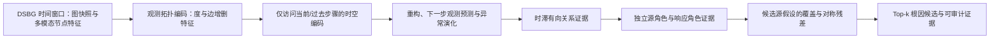

# REACR-RCA：动态拓扑感知的微服务根因候选排序

当前正式代码版本为 `3.1.0-reacr-rca`。V3.1 在 V3.0 的动态关系排序框架上补充 D1 真实加权动态图、严格的核心组件消融和 RQ1–RQ6 可复现实验入口。V3.0 及更早版本的分支、标签和历史文档保持不变。

## V3.1 相对 V3.0 的主要改进

1. **新增 D1 真实加权动态图**：从原始 AIOps Jaeger Span 恢复分钟级实例调用，并构造调用量、频率、平均/P95 延迟和错误率等边属性；原始无权 D1 不被覆盖。
2. **补充严格机制消融**：新增 `source_hypothesis_no_role` 与零时滞关系对照，使 LIPL、源—响应排序和候选源解释能够分别验证。
3. **完善论文实验复现**：新增 RQ1 基线、D1 核心组件消融、故障类型分析、参数敏感性、动态图强度分层和受控传播实验脚本。
4. **增强审计与防误用**：实现指纹纳入 D1 转换器；拓扑审计显式区分二值边集合、边权及边属性变化；D2 保留为历史固定拓扑数据，不进入当前论文主实验。
5. **扩充回归测试**：覆盖 D1 父子 Span 重建、加权图构造、基线输出、严格消融、参数运行协议和受控传播数据，共 79 项测试。

## V3 相对 V2.1 的主要改进

1. **真正消费时变图结构**：新增 8 维节点拓扑动态特征、逐时间步边/边属性聚合、`observed` 与 `freeze_first` 图序列模式，以及 changed/stable 分层评测；D1 的少量真实边变化可被使用，D2 明确作为固定拓扑退化情形。
2. **新增 SN/TT 真实动态图数据路径**：从 Jaeger `CHILD_OF` span 按时间桶重建调用图，保留空图、动态边、调用次数和 5 维边属性，并采用会话隔离的数据划分，避免时间窗口跨会话或集合泄漏。
3. **重建 D1 加权动态图**：从原始 AIOps Jaeger CSV 的 `trace_id/span_id/parent_span` 恢复 60 秒桶内的实例调用，计算调用次数、频率、平均/P95 延迟和错误率，同时保留 Pod--Node 部署边与自环；原无权 D1 不被覆盖。
4. **修正根因标签与排序口径**：标签匹配改为精确匹配或 `label + "-"` 边界安全前缀；服务级标签使用正候选袋和 any-hit 语义，主模型与 DeepHunt 基线均按袋内最高分训练。
5. **修正时间建模**：时间注意力默认使用因果掩码，下一步预测改为预测真实下一观测；新增正常窗口重构/预测预训练和监督阶段辅助动态损失。
6. **重构时滞关系学习**：使用样本与节点对特异的时滞权重、5D 时间对齐拓扑掩码、4D 时滞支持和空源概率，避免在无观测依赖时强制生成关系。
7. **重构源—响应解释与排序**：源角色和响应角色改为独立概率；原“反事实传播”改为候选源假设覆盖率与对称残差；图先验从末帧扩展为完整窗口聚合。
8. **增强跨服务校准**：新增不使用节点身份的统计校准器以及样本内神经/统计分数融合，用于 SN/TT 零样本场景；神经分数与融合分数可独立报告。
9. **增强可审计性与复现性**：新增拓扑审计、固定拓扑真消融、实现指纹、候选语义字段、逐边预测时滞、统一 runner 和完整回归测试。

## 版本与兼容性

| 版本 | 分支 / 标签 | 说明 |
| --- | --- | --- |
| V3.1 | `release/v3.1.0-reacr-rca` / `v3.1.0-reacr-rca` | 当前正式代码版本；新增 D1 加权动态图和 RQ1–RQ6 复现实验。 |
| V3.0 | `release/v3.0.0-reacr-rca` / `v3.0.0-reacr-rca` | 首个完整动态关系排序版本；内容保持不变。 |
| V2.1 | `release/v2.1.0-reacr-rca` | V2 模块命名规范化版本；内容保持不变。 |
| V2.0 | `v2.0.0-reacr-rca` | 根因—症状排序与旧反事实解释实现。 |
| V1.1 | `v1.1.0-reacr-stable` | 稳定基线版本。 |
| V1.0 | `v1.0.0-baseline` | 初始版本。 |

## 方法概览

REACR-RCA 从一段有序的微服务图快照中学习节点异常演化，并对可能的根因节点进行 Top-k 排序。当前主流程为：



1. **观测拓扑编码**：每个节点在每个时间步使用 8 个结构特征，包括入度、出度、入/出度变化，以及新增/移除的入边和出边。所有特征仅由序列化 DGL 快照中的边计算；代码不会补全目录边，也不会人为制造动态图。
2. **严格时间方向**：时间注意力默认使用上三角遮罩，过去状态不能读取未来步骤。预测分支以当前状态预测下一步的原始观测特征，并与对齐后的真实观测计算误差。
3. **正常动态学习**：正常滑动窗口用于重构/预测预训练，并在监督式根因排序阶段继续作为辅助约束。
4. **时滞有向关系证据**：关系头根据当前样本的源/目标轨迹生成成对、分时滞的有向关系强度。时间级掩码 `[B,L,W,target,source]` 只保留目标时刻 `t` 的真实图中存在边的 `(t-l,t)` 异常乘积，再沿有效时刻聚合。趋势/季节分解的移动平均核强制为正奇整数，非正、偶数或非整数（如 `5.5`）均提前拒绝，避免序列长度错位；该输出不是经过干预或可识别性证明得到的真实因果图。
5. **独立源/响应角色**：源角色与响应角色由两个独立分支估计。高响应负候选由模型挖掘，只是训练用的伪候选，不是数据集标注的症状节点。
6. **候选源假设解释**：对每个节点作为传播源的假设计算异常覆盖度和对称归一化残差，用于校正排序。这是基于观测关系的解释性检验，不是反事实干预效应。

历史代码中的 `causal_*`、`counterfactual_*`、`root_symptom_*` 名称为兼容旧结果而保留；论文和新实验报告应使用“时滞有向关系证据”“候选源假设解释”“独立源/响应角色”。

## 数据拓扑事实

拓扑审计直接读取 `samples/train_samples.pkl` 和 `samples/test_samples.pkl` 中的序列化图快照，不读取边目录来补边，也不添加自环。

| 数据集 | 图快照 | 节点数 | 唯一有向边集 | 相邻快照拓扑切换 | 每快照边数 | 边属性/边权 |
| --- | ---: | ---: | ---: | ---: | --- | --- |
| D1 | 7,200 | 46 | 8 | 15 | 200、202、256、262、266、268 | 无 |
| D1_weighted | 7,200 | 46 | 5,192 | 6,696 | 128–268 | `weight` + 8 维 `edge_attr` |
| D2（不用于当前论文） | 14,400 | 18 | 1 | 0 | 固定为 66 | 无 |

因此：

- D1 的序列化部署拓扑快照确实包含少量真实（非合成）边集变化，可以用于检验拓扑动态特征是否有效。按模型的 case 窗口统计，仅 `6/210`（2.86%）窗口包含拓扑变化；正常训练滑窗中为 `27/3705`，但这 27 个相互重叠的窗口只来自训练序列中的 3 次底层切换，不能当作 27 个独立部署事件。审计只能证明边集发生变化；若要把变化解释为扩缩容、重部署或故障传播，还需要额外部署/追踪证据。
- D1_weighted 以原始 D1 的相同 46 个节点、130 维节点特征和原训练/测试划分为基础，将旧 Pod--Pod 调用目录边替换为每分钟真实观察到的跨实例调用；全部 7,200 个快照都有调用边，调用权重签名在 7,199 个相邻时间对中均发生变化。
- D2 是固定拓扑数据，不能验证拓扑演化建模，因此不再作为当前论文的数据集；历史配置与数据说明仅为兼容旧结果保留。
- 原始处理版 D1 和 D2 均没有边权；论文主实验应使用独立的 D1_weighted，不能把新构造的 Trace 边权倒写成旧 D1 原生 `edata`。

完整审计说明见 [`docs/TOPOLOGY_AUDIT.md`](docs/TOPOLOGY_AUDIT.md)。

## 根因标签与评测语义

`cases.csv` 提供故障 case 的根因标识，但 D1 的标签粒度并不完全一致：

- 若标签与图节点名完全相同，则只标记该节点。
- 若标签是服务级名称，则只匹配 `标签 + "-"` 开头的实例名，可以得到多个正候选；例如服务标签可以对应多个副本。
- 不再使用无边界字符串前缀匹配，因此 `paymentservice` 不会误匹配 `paymentservice2-0`。
- 默认情况下，零匹配标签会立即报错，避免将无正样本 case 静默带入训练和评测。

对 D1 全部 210 个 case 的实际映射审计显示：136 个 case 只匹配 1 个节点，74 个 case 匹配同一服务的 3 个副本。后三者构成一个**正候选袋**：数据只支持“袋中任一副本命中即可”，并不支持把三个副本分别都当作已验证真根因。主模型和 DeepHunt 基线的排序损失均使用袋内最高分 `max`，A@K 同样检查 Top-k 是否命中袋内任一候选，使两种方法的训练、manifest/run config 与 any-hit 评测口径一致。D1 应报告为混合粒度根因候选定位，并导出每个 case 的 `label_nodes` 供审计。

运行元数据使用通用语义 `root_label_semantics=positive_candidate_bag_any_hit`，并单独记录数据集粒度：D1 为 `mixed_service_to_instance_candidate_bag`，D2 为 `exact_single_instance_candidate`。这样不会把 D2 的精确单实例标签误写成服务到副本袋，也不会把 D1 的候选袋误写成三个独立真值。

DeepHunt 的候选袋损失直接作用于原始有界分数，不再做样本内 min–max 归一化。默认 margin 为 `1/rank_range`；袋内最高分分别与负候选计算 margin violation，负候选按排名权重加权并除以权重和。该形式避免近并列分数通过 `1/(max-min)` 产生约 `10^11` 量级梯度；常数分数和近并列测试均得到有限梯度，最大绝对梯度不超过 1。

## 代码结构

| 文件 | 作用 |
| --- | --- |
| `reacr_rca_pipeline.py` | 单次训练、验证、测试、拓扑审计和结果导出入口。 |
| `models/reacr_rca_dsbg_dataset.py` | 构造时序窗口，并执行边界安全的多正根因标签映射。 |
| `models/reacr_rca_topology_dynamics.py` | 从真实快照提取并编码静态度与动态边增删特征。 |
| `models/reacr_rca_dynamic_backbone.py` | 图空间编码、拓扑特征融合、GRU 和带时间方向约束的注意力。 |
| `models/reacr_rca_modality_gate.py` | 按显式索引/区间处理 metric、trace、log；支持 D1 非连续 metric 区间。 |
| `models/reacr_rca_anomaly_head.py` | 观测空间重构、下一步预测与异常演化评分。 |
| `models/reacr_rca_causal_head.py` | 兼容文件名；实现时间级 5D/时滞级 4D 拓扑支持、成对时滞有向关系证据和空源概率。 |
| `models/reacr_rca_causal_ranker.py` | 聚合整段图序列与逐时刻异常的图先验，并计算独立源/响应角色及候选源假设覆盖/残差。 |
| `models/reacr_rca_trainer.py` | 正候选袋 max 排序、弱相对角色约束、候选源解释、一致性与正常动态辅助训练。 |
| `tools/reacr_rca_topology_audit.py` | 审计实际序列化图快照的边集、切换、边属性和来源。 |
| `tools/convert_d1_weighted_dynamic.py` | 从 D1 原始 Jaeger Span 重建分钟级调用边及其调用量、延迟和错误率。 |
| `tools/reacr_rca_final_study_runner.py` | 统一运行多 seed 主实验与消融实验。 |

更完整的代码边界见 [`MANIFEST.md`](MANIFEST.md)，本轮语义修正见 [`docs/METHOD_CORRECTIONS.md`](docs/METHOD_CORRECTIONS.md)。

## 数据格式

数据不随仓库提交。运行前需要准备：

```text
data/D1_weighted/
  cases.csv
  graphs_info/node_hash.pkl
  graphs_info/call_edges.pkl
  graphs_info/structural_edges.pkl
  samples/train_samples.pkl
  samples/test_samples.pkl
```

每个样本为 `(timestamp, graph, feature_tensor)`。图节点编号通过 `node_hash.pkl` 解释。当前主实验使用 SN、TT 和 D1_weighted 的实际时间图快照；D2 仅保留为历史固定拓扑数据，不进入当前论文主实验。`call_edges.pkl` 仅记录观察调用边目录，不作为拓扑审计或动态特征提取时的补边来源。

## 运行与审计

先审计数据集中实际保存的拓扑：

```bash
python -m tools.reacr_rca_topology_audit \
  --dataset D1_weighted \
  --output data/D1_weighted/topology_audit.json
```

单次开发运行示例：

```bash
python reacr_rca_pipeline.py \
  --dataset D1_weighted --device cuda --seed 0 \
  --case_split_protocol time_strict \
  --ranker_mode source_hypothesis \
  --enable_topology_dynamics \
  --graph_sequence_mode observed \
  --topology_feature_mode full \
  --relation_topology_mode undirected \
  --enable_explanation_losses \
  --normal_pretrain_epochs 3 \
  --normal_auxiliary_loss_weight 0.1 \
  --normal_topology_change_oversample_factor 4 \
  --train_epochs 20 \
  --output_dir res/d1_v3
```

正式结果应通过统一 runner 重新生成：

```bash
python -m tools.reacr_rca_final_study_runner \
  --datasets SN TT D1_weighted \
  --mode all \
  --main_seeds 0 1 2 3 4 \
  --baseline_seeds 0 1 2 3 4 \
  --ablation_seeds 0 1 2 3 4 \
  --base_dir res/reacr_rca_v3_rerun
```

runner 默认主模型和 DeepHunt 基线为五 seed、消融为三个 seed（0–2）；上例显式把消融也扩展为五 seed，用于生成全量五 seed 论文结果。

## SN/TT 真实动态图数据路径

D2 没有逐时刻调用边观测，因此仍作为固定拓扑退化数据集；代码不会通过随机扰动或全连接补图制造“动态图”。为让 REACR-RCA 在真实时间变化边上训练，仓库新增了 SN/TT 原始遥测转换器：它从 Jaeger `CHILD_OF` 父子 span 按时间桶重建 `caller → callee` 图，固定服务节点对齐时间序列，但每步边集、调用次数和 5 维边属性均来自当时观测，空桶保留为空图。

```bash
python tools/convert_eadro_dynamic.py \
  --dataset both \
  --input-root '/path/to/Eadro/chunks' \
  --output-root data \
  --overwrite

python reacr_rca_pipeline.py \
  --dataset SN --device cpu \
  --max_train_windows 8 --max_case_windows 8 \
  --output_dir res/sn_dynamic_smoke

python reacr_rca_pipeline.py \
  --dataset TT --device cpu \
  --max_train_windows 8 --max_case_windows 8 \
  --output_dir res/tt_dynamic_smoke
```

SN 使用 10 秒桶和严格 120 秒故障窗口；TT 使用 60 秒桶和严格 600 秒故障窗口。窗口不会跨采集会话，同一会话不会跨训练/验证/测试集合。全量转换审计得到 SN/TT 分别 344/281 次边集切换和 987/289 次边权切换。详见 [SN/TT 动态图说明](docs/DYNAMIC_SN_TT.md)。

## D1 真实加权动态图数据路径

原始 AIOps-Dataset 的五份 `trace_jaeger-span.csv` 包含毫秒时间戳、实例名、`trace_id`、`span_id`、`parent_span`、持续时间和状态码。转换器以 60 秒聚合跨实例父子 Span，并为调用边生成调用次数、频率、平均/P95 延迟、错误率和三类边类型标记。Pod--Node 部署边和自环从同一时间戳的旧图中保留；旧 Pod--Pod 调用目录边被真实观察调用替换。

```bash
python -m tools.convert_d1_weighted_dynamic \
  --raw-root '/path/to/Aiops-Dataset' \
  --source-root '/path/to/processed/D1' \
  --output-root data/D1_weighted \
  --overwrite

python reacr_rca_pipeline.py \
  --dataset D1_weighted --device cuda --seed 0 \
  --output_dir res/d1_weighted
```

本次全量审计处理 44,858,388 条 Span；五个文件的父子关系解析率均高于 99.99%，没有未映射实例、时间逆序行或迟到调用。结果包含 5,192 种边集合、6,696 次边集切换和 7,199 次调用权重签名切换。详细字段见 [`docs/D1_WEIGHTED_DYNAMIC.md`](docs/D1_WEIGHTED_DYNAMIC.md)。

## 拓扑贡献的必要消融

至少使用相同数据划分、seed 和训练预算比较：

| runner 变体 | 关键参数 | 可检验内容 |
| --- | --- | --- |
| 主模型 | `--graph_sequence_mode observed --enable_topology_dynamics --topology_feature_mode full` | 使用观测图序列、静态度和真实边增删特征。 |
| `no_topology_change_features` | `--graph_sequence_mode observed --topology_feature_mode static_only` | 只移除六个显式变化通道；空间消息传递、关系掩码和图先验仍使用每步观测图。 |
| `topology_dynamic_features_only` | `--graph_sequence_mode observed --topology_feature_mode dynamic_only` | 只保留显式边变化通道。 |
| `frozen_window_topology` | `--graph_sequence_mode freeze_first` | 把同一窗口的全部步骤替换为该窗口首个真实图；同时冻结空间消息传递、拓扑特征、关系掩码和图先验，是当前真正的固定拓扑对照。 |
| `no_explicit_topology_encoder` | `--disable_topology_dynamics` | 仅移除显式 8 维拓扑编码器；其他使用图结构的分支仍保留。 |
| `no_relation_topology_constraint` | `--relation_topology_mode none` | 移除关系候选的观测图约束。 |
| `no_topology_change_oversampling` | `--normal_topology_change_oversample_factor 1` | 移除正常训练窗口的变化窗口过采样。 |

`static_only` 不是“固定拓扑”：它只把显式变化特征置零，图卷积等分支仍能看到变化后的边集。因此，动态图结论不能只依赖主模型与 `static_only` 的差值；应同时报告 `frozen_window_topology`。当前论文的动态图证据应来自 D1_weighted、SN 和 TT；D2 不进入主实验。

旧 D1 的变化窗口非常稀少；D1_weighted 的真实调用边几乎逐分钟变化，不再把旧 D1 的 `6/210` 稀疏变化结论用于新数据。正式结果仍须报告窗口级拓扑统计，并使用二值动态边、冻结窗口图和去除边属性等消融分别验证边集合与边权的贡献。

实现级检查已在 D1_weighted 的最终重建数据上完成：8 个正常窗口都包含拓扑变化，前向过程提取到 2,676 个非零动态特征；一次正常预训练和一次根因训练后，动态投影梯度范数分别为 `1.48×10^-3` 和 `1.63×10^-3`，边证据梯度范数为 `7.15×10^-3`。这证明当前计算图实际消费了观察边变化及其属性，但不证明其能提升定位性能；性能结论仍需完整多 seed 消融。

## 输出与能力边界

常用输出包括 `topology_audit.json`、`final_eval.json`、`validation_eval.json`、`eval_predictions.csv`、角色诊断及可选事件链。拓扑审计中的“是否固定/是否存在变化”字段由实际审计结果计算，不再无条件写死。关系头同时导出：

- `lag_alignment_topology_mask[B,L,W,target,source]`：真正参与每个 `(t-l,t)` 乘积筛选的时间级支持；
- `lag_topology_mask[B,L,target,source]`：沿时间维取并集后的 4D 时滞支持，用于时滞分布的合法性约束；
- `topology_mask[B,target,source]`：再沿时滞取并集的窗口级支持。

事件链为每条路径边导出 argmax/期望预测时滞和置信度，并与异常起始时滞计算一致率和误差。主术语为 `model_relation_only`（模型关系存在、但观测图中无对应方向边）；`causal_inferred` 仅作为弃用兼容别名。新 CSV 的主证据字段为 `source_role_score`、`response_role_score`、`source_hypothesis_coverage/residual`，旧 `root/symptom/counterfactual` 字段只为兼容历史脚本保留。

候选语义也贯穿全部导出：节点 artifact 使用 `is_label_candidate`；事件链使用 `candidate_node`、`label_candidate_nodes`、`candidate_is_label_match`；链验证使用 `pred_candidate`、`label_candidates`、`candidate_hit`；角色诊断使用 `label_candidate_node`、`response_candidate_node`。对应的 `is_root_label`、`root_node`、`true_roots`、`hard_symptom_*` 等仅为弃用别名。诊断主指标为 `response_candidate_error_rate` 和 `label_vs_response_candidate_margin_mean`，角色指标优先使用 `candidate_membership_auc`、`source_role_gap`、`response_role_gap`（汇总字段带 `_mean`）；旧 `hard_symptom_error_rate`、`root_vs_hard_symptom_margin_mean`、`role_auc`、`root_role_gap` 只保留兼容。runner 报告标题为 “Source-Response Candidate Diagnostic”，避免把响应候选写成已标注症状。这些仍是模型证据，不是真实传播链标签。

- 数据集提供根因标签，但未提供逐时刻真实因果图、干预结果、症状节点标签或真实传播链。
- “根因标签”表示数据集给定的故障归因标识；服务级标签映射出的多个副本是候选集合，不意味着每个副本都是分别验证过的真实根因实例。
- 正式 runner 对主模型和 DeepHunt 基线默认都使用 5 个 seed（0–4），消融默认使用 3 个 seed（0–2）；若论文要求全量五 seed 消融，必须显式传入 `--ablation_seeds 0 1 2 3 4`。runner 把版本号和关键代码/配置文件的 SHA-256 implementation fingerprint 写入运行清单；指纹不一致时不会静默复用旧结果。
- changed/stable 的 case 数与 A@1/A@3/A@5 已进入 `all_runs.csv`、多 seed 汇总和最终 Markdown 报告，而不只保存在单次 `final_eval.json` 中。
- 当前 79/79 项单元测试以及 D1_weighted/SN/TT 真实数据小规模端到端运行均已通过。D1_weighted 的 1-epoch 烟测得到非零拓扑动态投影梯度 `1.63e-3` 和边证据梯度 `7.15e-3`；这些只证明实现与数据路径可运行，不等于完整多 seed 性能收益证据。
- V3.1 不提交原始数据、模型权重或大规模实验产物。论文中的性能、动态图收益和机制结论应通过发布的锁定协议与实验脚本复现，不应从 smoke test 推导。
